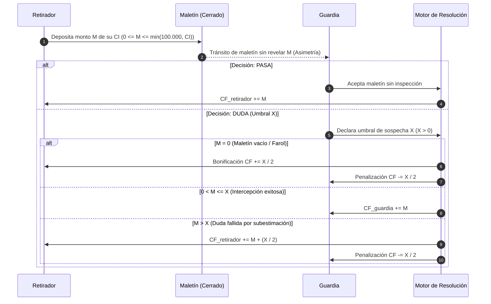

# StrategIA · The Briefcase Dilemma (El Dilema del Maletín)

[](https://react.dev/)
[](https://www.typescriptlang.org/)
[](https://vitejs.dev/)
[](https://tailwindcss.com/)
[](https://fastapi.tiangolo.com/)
[](https://www.python.org/)

**StrategIA** es una plataforma y laboratorio interactivo para el estudio de **Teoría de Juegos** y toma de decisiones bajo **Información Asimétrica**, inspirada en el protocolo experimental del *Dilema del Maletín* (*The Briefcase Dilemma*). 

La plataforma permite simular, visualizar y auditar enfrentamientos estratégicos a lo largo de un protocolo iterado de 50 rondas, enfrentando agentes autónomos impulsados por Inteligencia Artificial (heurísticas deterministas, inferencia bayesiana, Q-Learning tabular, PPO estocástico, Modelos de Lenguaje LLM) y usuarios humanos en tiempo real.

---

##  El Dilema del Maletín: Reglas del Juego

El juego modela una negociación repetida de 50 rondas entre dos participantes (**Jugador A** y **Jugador B**) con alternancia estricta de roles:

- En rondas impares: **Jugador A** es el *Retirador* y **Jugador B** es el *Guardia*.
- En rondas pares: **Jugador B** es el *Retirador* y **Jugador A** es el *Guardia*.

### Estructura Financiera de Cuentas
Cada participante gestiona dos cuentas independientes:
1. **Cuenta Inicial (CI)**: \$2,000,000 asignados al inicio. Representa el capital disponible para arriesgar en los retiros.
2. **Cuenta Final (CF)**: \$500,000 asignados al inicio. Representa el saldo consolidado acumulado que determina al ganador al término de las 50 rondas.

### Dinámica de una Ronda (4 Fases)



### Matriz de Pagos y Liquidación

| Decisión Guardia | Condición del Retiro ($M$) | Saldo Retirador ($\Delta CF$) | Saldo Guardia ($\Delta CF$) | Resultado / Evento | Significado Económico |
| :--- | :--- | :--- | :--- | :--- | :--- |
| **PASA** | Cualquier $M$ | $+M$ | $0$ | `pass` | Retiro consolidado sin revisión. El maletín permanece cerrado. |
| **DUDA ($X$)** | $M = 0$ *(Farol / Vacío)* | $+\frac{X}{2}$ | $-\frac{X}{2}$ | `failed-doubt` | Falsa alarma. El guardia paga penalización al retirador. |
| **DUDA ($X$)** | $0 < M \le X$ *(Atrapado)* | $0$ | $+M$ | `caught` | Intercepción total. El guardia captura el capital extraído. |
| **DUDA ($X$)** | $M > X$ *(Subestimado)* | $+M + \frac{X}{2}$ | $-\frac{X}{2}$ | `failed-doubt` | El guardia subestimó el retiro: pierde el monto y paga penalización. |

---

##  Protocolo de Información Asimétrica y Revelación Cada 10 Rondas

El núcleo científico de StrategIA es el estricto aislamiento de información entre participantes, modelando un entorno de información incompleta:

### 1. Desconocimiento Total de Saldos Rivales (Rondas 1 a 10)
Durante las primeras 10 rondas, ningún agente ni jugador conoce el estado financiero del rival:
- `opponent_ci = None`
- `opponent_cf = None`
Los agentes deben actuar únicamente guiados por su política base y las observaciones inmediatas de sus propias acciones.

### 2. Puntos de Revelación Periódica (Checkpoints en Rondas 10, 20, 30, 40 y 50)
Al finalizar cada bloque de 10 rondas, el motor oficial del juego (`GameEngine` / `SessionManager`) ejecuta un corte formal de auditoría (`revealed = True`):
- Se hace público el saldo consolidado acumulado ($CI$ y $CF$) de ambos jugadores en ese instante exacto.
- **Congelamiento de Información**: Durante las rondas 11 a 20, los agentes conocen la fotografía financiera correspondiente a la **ronda 10**. Durante las rondas 21 a 30, conocen la fotografía de la **ronda 20**, y así sucesivamente.
- Durante las rondas intermedias de un bloque, las fluctuaciones en tiempo real del saldo del rival permanecen estrictamente ocultas.

### 3. Certeza Ronda a Ronda: Acierto o Fallo de Duda
Ronda a ronda, la **única certeza** que recibe el guardia al tomar una decisión es el resultado del evento:
- `recent_outcomes`: Secuencia de resultados de sus decisiones de guardia (`"caught"`, `"failed-doubt"`, `"pass"`).
- **Cero Filtración de Montos Secretos**: Si el guardia decide pasar (`"pass"`), el maletín **no se abre** y el valor numérico de $M$ nunca se le revela. El agente solo conoce el monto numérico si lo interceptó con éxito (`"caught"`) o a través de las revelaciones contables de los bloques de 10 rondas.

---

##  Catálogo de Modelos y Mecanismos de Adaptación

Todos los agentes implementan la interfaz común `BaseAgent` y adaptan activamente su comportamiento en dos niveles:
1. **Nivel Macroeconómico (Cada 10 rondas)**: Ajuste de riesgo ante revelación de cuentas (modo *remontada* vs. modo *conservación de ventaja*).
2. **Nivel Microeconómico (Ronda a ronda)**: Ajuste según la certeza del último resultado de guardia (`caught` vs. `failed-doubt`).

| Identificador | Modelo / Política | Adaptación Macroeconómica (Cada 10 Rondas) | Adaptación Microeconómica (Ronda a Ronda) |
| :--- | :--- | :--- | :--- |
| `rules` | **Reglas Heurísticas** | Si va perdiendo ($\text{CF}_{\text{rival}} > \text{CF}_{\text{propio}}$), eleva el riesgo de retiro hasta un $95\%$ y duda cada 2 rondas para interceptar capital. Si va ganando, reduce el riesgo al $20\%$ y duda cada 4 rondas para protegerse de penalizaciones $X/2$. | Si la última duda falló (`failed-doubt`), incrementa el umbral $X$ para evitar penalizaciones repetidas. |
| `probabilistic` | **Inferencia Bayesiana** | Si el rival va rezagado, el *prior* bayesiano asume que intentará retiros desesperados (aumenta $P(\text{alto})$). Si el propio agente va perdiendo, escala su nivel base de retiro. | Si la última duda acertó (`caught`), eleva la confianza posterior; si falló (`failed-doubt`), reduce la probabilidad de dudar. |
| `q-learning` | **Q-Learning Tabular** | Incorpora a su espacio de estados la posición revelada: `position ∈ {"unknown", "ahead", "behind"}`. En estado `"behind"` activa un sesgo de intercepción de emergencia. | Si la última duda falló, modula hacia abajo el umbral de duda para minimizar pérdidas en la Cuenta Final. |
| `ppo` | **PPO Estocástico** | Modula dinámicamente sus pesos de política: mayor `withdrawal_bias` y `guard_bias` ante déficit de $CF$; política defensiva si mantiene el liderazgo. | Bonificación de probabilidad de duda tras acierto (`caught`) y reducción tras penalización (`failed-doubt`). |
| `llm` | **Large Language Model** | Prompt enriquecido con saldos revelados (`opponent_ci`, `opponent_cf` o `"hidden"`). Heurística de fallback con escala de riesgo adaptativo ($30\%$–$90\%$). | Modula la agresividad de duda en base a `last_guard_outcome`. Cuenta con circuit breaker de 30s ante caídas de API. |
| `human` | **Control Humano** | Control manual interactivo con validación de rejilla ($1$ o $10,000$) y saldo disponible en $CI$. | Notificación visual de aciertos, capturas y penalizaciones descontadas en tiempo real. |

---

##  Modos de Juego y Desacoplamiento de Datos de Prueba

El sistema opera bajo una arquitectura **100% desacoplada del frontend**:

1. **AI vs AI (`ai-ai`)**:
   - Simulación íntegramente calculada en el backend FastAPI y transferida con trazabilidad completa de 50 rondas reproducibles mediante semilla (`seed`).
   - Visualización con animación física por fases o barra de reproducción rápida con inspección por turnos.
2. **Human vs AI (`human-ai`)**:
   - Enfrentamiento por turnos entre un usuario y cualquiera de las IAs. Las decisiones del usuario se envían vía `POST /turn` y el motor avanza hasta el próximo estado que requiera interacción.
3. **Human vs Human (`human-human`)**:
   - Enfrentamiento local entre dos personas en el mismo dispositivo.
   - Incluye **Pantalla de Privacidad** (*Privacy Curtain*) que oculta el monto del maletín antes de ceder el control al guardia.
4. **Cero Mocks en Frontend**:
   - El archivo de datos simulados cliente (`mockSimulationData.ts`) ha sido **completamente eliminado**.
   - El servicio `game.service.ts` se conecta directamente a la API REST. Si el backend se detiene, la interfaz muestra un aviso de desconexión transparente en lugar de generar partidas ficticias.

---

##  Observatorio Cuantitativo y Analíticas por Bloques

El panel de analíticas procesa únicamente rondas consolidadas:

- **Comparativa por Bloques de 10 Rondas por Jugador**:
  - Desglose independiente para **Jugador A** y **Jugador B** en cada bloque de observación (10 registros por partida: 5 bloques $\times$ 2 jugadores).
  - Métricas calculadas por jugador:
    - **Retiro Promedio**: Intensidad del riesgo asumido como Retirador.
    - **Capital Expuesto**: Sumatoria de montos arriesgados de su $CI$.
    - **Frecuencia de Duda**: Porcentaje de turnos como Guardia donde decidió dudar.
    - **Precisión del Guardia**: Tasa de acierto ($0 < M \le X$) sobre el total de dudas.
    - **Penalizaciones $CF$**: Capital total perdido por dudas fallidas ($X/2$).
    - **Capital Capturado**: Capital confiscado al rival mediante intercepciones exitosas.
    - **Indicadores de Tendencia**: Comparación directa ($\uparrow$ aumento / $\downarrow$ descenso) respecto al desempeño del mismo jugador en el bloque anterior.
- **Tarjetas de Perfil Estratégico**: Radiografía dividida en Riesgo como Retirador y Riesgo como Guardia para cada jugador.
- **Curvas de Evolución de Cuentas**: Gráfico en tiempo real que traza $CI_A$, $CF_A$, $CI_B$ y $CF_B$ a lo largo de las 50 rondas.
- **Historial Completo de Rondas**: Tabla cronológica detallada con indicadores de rol, monto, decisión, umbral, resultado y deltas de saldo.
- **Exportación de Datos**: Descarga de la partida en formatos **CSV** y **JSON**.

---

##  Arquitectura del Repositorio

```
StrategIA/
├── backend/                         # Backend en Python / FastAPI
│   ├── app/
│   │   ├── agents/                  # Políticas estratégicas de IA
│   │   │   ├── base.py              # BaseAgent y Observation (con opponent_ci y recent_outcomes)
│   │   │   ├── rule_agent.py        # Agente heurístico determinista adaptativo
│   │   │   ├── prob_agent.py        # Agente de inferencia bayesiana
│   │   │   ├── q_learning.py        # Agente Q-Learning tabular (con estado de posición relativa)
│   │   │   ├── ppo_agent.py         # Agente PPO estocástico con ajuste por ventaja
│   │   │   ├── llm_agent.py         # Conector Ollama/Local con fallback heurístico dinámico
│   │   │   └── registry.py          # Factoría constructora de agentes
│   │   ├── api/
│   │   │   └── routes.py            # Endpoints REST (/game, /models, /analytics, /export)
│   │   ├── core/
│   │   │   ├── config.py            # Parámetros y reglas del experimento
│   │   │   ├── engine.py            # GameEngine: resolución formal, validación y observación
│   │   │   └── entities.py          # Entidades de dominio (RoundRecord, Simulation, GameState)
│   │   ├── schemas/
│   │   │   └── game_schemas.py      # Esquemas Pydantic v2
│   │   └── services/
│   │       ├── analytics.py         # Cálculo de métricas por jugador en bloques de 10 rondas
│   │       └── session_manager.py   # Orquestador de partidas humanas y de IA
│   ├── tests/                       # Suite de pruebas automatizadas con pytest
│   │   ├── test_api.py              # Tests de contratos REST y exportaciones
│   │   └── test_engine.py           # Tests de reglas, asimetría de información y revelación
│   ├── main.py                      # Punto de entrada FastAPI con CORS
│   └── requirements.txt             # Dependencias del backend
│
├── frontend/                        # Frontend en React 19 + TypeScript + Vite + Tailwind v4
│   ├── src/
│   │   ├── app/
│   │   │   ├── components/
│   │   │   │   ├── arena/           # Escenario del maletín y animaciones físicas
│   │   │   │   ├── controls/        # Controles de juego, configuración y reproducción
│   │   │   │   ├── metrics/         # RiskMetricsPanel (con tabla de bloques por jugador)
│   │   │   │   ├── ui/              # Componentes visuales reutilizables
│   │   │   │   ├── Layout.tsx       # Estructura principal con barra de estado
│   │   │   │   └── ModelsPanel.tsx  # Catálogo de agentes
│   │   │   └── App.tsx              # Componente raíz
│   │   ├── hooks/
│   │   │   └── useGameEngine.ts     # Hook orquestador conectado al backend
│   │   ├── services/
│   │   │   ├── _http/apiClient.ts   # Cliente HTTP fetch contra FastAPI
│   │   │   └── game.service.ts      # Servicio unificado (isBackendEnabled = true)
│   │   ├── index.css                # Tailwind CSS v4
│   │   └── main.tsx                 # Entrada React 19
│   ├── package.json                 # Dependencias del frontend
│   └── vite.config.ts               # Configuración Vite con proxy backend
│
├── package.json                     # Scripts del workspace raíz
└── README.md                        # Esta documentación
```

---

##  Comandos para Correr el Proyecto

### 1. Clonar el Repositorio
```bash
git clone <URL_DEL_REPOSITORIO>
cd StrategIA
```

### 2. Levantar el Backend (FastAPI)

Abre una terminal dedicada para el backend:

#### En Windows (PowerShell):
```powershell
# 1. Navegar a la carpeta del backend
cd backend

# 2. Crear entorno virtual de Python
python -m venv .venv

# 3. Activar el entorno virtual
.venv\Scripts\Activate.ps1

# 4. Instalar dependencias
pip install -r requirements.txt

# 5. Iniciar el servidor FastAPI en el puerto 8000
uvicorn main:app --reload --port 8000
```

#### En Linux / macOS:
```bash
# 1. Navegar a la carpeta del backend
cd backend

# 2. Crear entorno virtual de Python
python3 -m venv .venv

# 3. Activar el entorno virtual
source .venv/bin/activate

# 4. Instalar dependencias
pip install -r requirements.txt

# 5. Iniciar el servidor FastAPI en el puerto 8000
uvicorn main:app --reload --port 8000
```

> **Verificación:** El backend estará disponible en `http://localhost:8000`. Puedes abrir la documentación interactiva Swagger en `http://localhost:8000/docs` o comprobar el estado en `http://localhost:8000/health`.

---

### 3. Levantar el Frontend (React + Vite)

Abre una **segunda terminal** en la raíz del proyecto o en `frontend/`:

```bash
# 1. Instalar dependencias con pnpm
pnpm install

# 2. Iniciar el servidor de desarrollo de Vite
pnpm run dev
```

> **Acceso:** Abre tu navegador en **`http://localhost:8443`** (o `http://localhost:5173`). Verás el indicador verde de **BACKEND ONLINE** en la barra lateral superior.

---

##  Ejecución de Pruebas y Validación de Tipos

### Backend (15 Pruebas con `pytest`)
Verifica la integridad de las reglas, la asimetría de información cada 10 rondas, la resolución económica y los contratos de la API REST:

```powershell
# En Windows (PowerShell desde la raíz):
$env:PYTHONPATH='backend'; pytest backend/tests -v

# En Linux / macOS:
PYTHONPATH=backend pytest backend/tests -v
```

### Frontend (Validación Estricta de Tipos TypeScript)
Comprueba que no existan errores de tipos o referencias rotas en los componentes de React:

```bash
# Desde la carpeta frontend o usando pnpm
pnpm --filter ./frontend exec tsc --noEmit
```

---

##  Endpoints Principales de la API REST

| Método | Endpoint | Descripción |
| :--- | :--- | :--- |
| `GET` | `/health` | Chequeo de salud del servicio backend (`{"status": "ok"}`). |
| `GET` | `/api/v1/models` | Catálogo de los 6 modelos estratégicos disponibles con descripción. |
| `POST` | `/api/v1/game/start` | Inicia una simulación automatizada o crea una sesión humana por turnos. |
| `GET` | `/api/v1/game/{game_id}` | Obtiene el estado actual, las rondas resueltas y el turno pendiente. |
| `POST` | `/api/v1/game/{game_id}/turn` | Envía el retiro ($M$) o la decisión de guardia (`pass`/`doubt` con $X$) en partidas interactivas. |
| `GET` | `/api/v1/game/{game_id}/analytics` | Genera las métricas de riesgo globales y las métricas segmentadas por jugador cada 10 rondas. |
| `GET` | `/api/v1/game/{game_id}/export?format=csv\|json` | Descarga el dataset de la simulación en formato CSV o JSON. |

---

##  Variables de Entorno

### Backend (`backend/`)
| Variable | Por Defecto | Descripción |
| :--- | :--- | :--- |
| `CORS_ORIGINS` | `http://localhost:5173,http://localhost:8443` | Orígenes HTTP autorizados para interactuar con la API. |
| `STRATEGIA_LLM_URL` | `http://localhost:11434/api/generate` | Endpoint del modelo de lenguaje local para el agente `llm`. |
| `STRATEGIA_LLM_MODEL`| `llama3.2` | Modelo de lenguaje a solicitar en el prompt estructurado. |

### Frontend (`frontend/.env`)
| Variable | Por Defecto | Descripción |
| :--- | :--- | :--- |
| `VITE_API_URL` | `http://localhost:8000` | URL base del servidor FastAPI. |
| `VITE_USE_MOCK` | `false` | Desactiva por completo cualquier intento de emulación cliente. |

---

##  Licencia

Este proyecto fue desarrollado con fines educativos y de investigación científica en toma de decisiones estratégicas, teoría de juegos, economía del comportamiento y sistemas multiagente.
